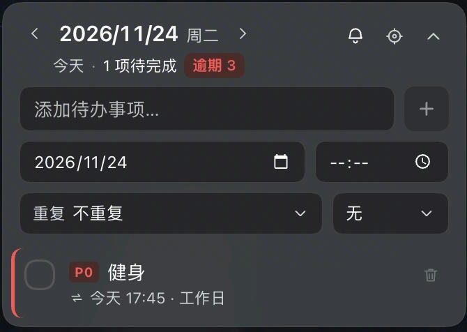
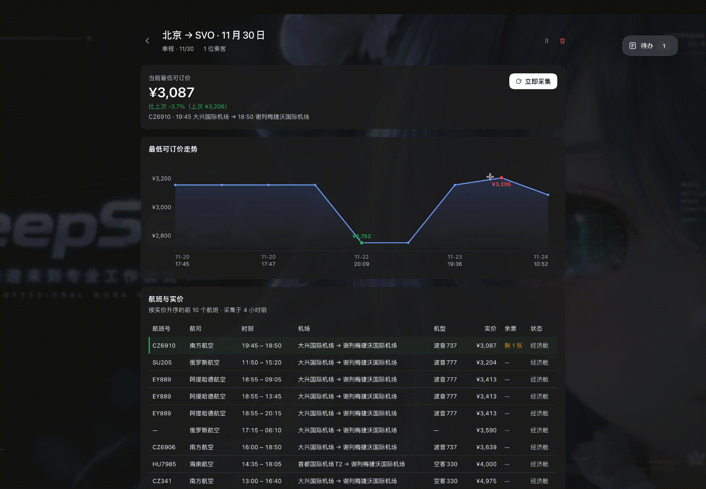

<div align="center">

# Oh My DSH Plugin

**个人开发、开箱即用的 [DeepSeek Harness](https://github.com/deepseek-ai/deepseek-harness)（DSH）插件集合**

[](./LICENSE)

</div>

## 简介

每个插件是一个独立的 npm 包，装上就能在 DSH 的 Web UI 里多一块能力，不用改 DSH 本身，也不用自己编译。

- **开箱即用**：一条安装命令，刷新页面即可使用。
- **独立打包**：一个插件一个包，按需安装、互不依赖。
- **本地优先**：数据默认存在本机，不上传。

## 插件列表

| 插件 | 能做什么 | npm 包名 |
| --- | --- | --- |
| [待办清单](./packages/dsh-todo-list/README.md) | <br>右上角悬浮待办面板：按天查看、重复事项每日独立实例、优先级与到点提醒。 | [`@ultraslow/dsh-todo-list`](https://www.npmjs.com/package/@ultraslow/dsh-todo-list) |
| [Skills & MCP](./packages/dsh-skill-mcp-manager/README.md) | <br>按 DSH 真实优先级开关 Skill（只对模型隐藏，`/名字` 仍可用），并管理全局与工作区两级 MCP。 | [`@ultraslow/dsh-skill-mcp-manager`](https://www.npmjs.com/package/@ultraslow/dsh-skill-mcp-manager) |
| [开屏与壁纸](./packages/dsh-boot-skin/README.md) | <br>启动时播放自己的开屏视频，并把图片/视频铺成整屏壁纸，参数实时可调。 | [`@ultraslow/dsh-boot-skin`](https://www.npmjs.com/package/@ultraslow/dsh-boot-skin) |
| [机票 / 酒店价格监控](./packages/dsh-price-watch/README.md) | <br>盯机票与酒店价格：看未来一年最低价，或按日期采真实报价，变化时推飞书卡片。 | [`@ultraslow/dsh-price-watch`](https://www.npmjs.com/package/@ultraslow/dsh-price-watch) |

## 安装方式

`<profile>` 换成你的 profile 名（如 `desktop`、`web`）。

**从插件市场**：DSH 里打开 **插件 → 实验性插件 → 自定义插件索引**，添加索引源

```text
https://raw.githubusercontent.com/Hankerlove/oh-my-dsh-plugin/main/market/index.json
```

然后在 **插件 → 发现** 里选择安装。

**从 npm**：

```sh
dsh plugin --profile <profile> add @ultraslow/dsh-todo-list
dsh plugin --profile <profile> add @ultraslow/dsh-skill-mcp-manager
dsh plugin --profile <profile> add @ultraslow/dsh-boot-skin
dsh plugin --profile <profile> add @ultraslow/dsh-price-watch
```

**从源码**：

```sh
git clone https://github.com/Hankerlove/oh-my-dsh-plugin.git
cd oh-my-dsh-plugin
dsh plugin --profile <profile> add ./packages/dsh-price-watch
```

装完用该 profile 启动 DSH 并刷新页面即可；卸载把 `add` 换成 `remove`。

## 插件使用

### [待办清单](./packages/dsh-todo-list/README.md)

- **入口**：页面右上角的悬浮面板，收起后是可拖动的小胶囊。
- **添加待办**：标题 + 日期 + 可选时间 + 重复规则 + 优先级，回车即添加。
- **重复规则**：不重复 / 工作日 / 周末 / 每天 / 每周 / 每月 / 每年，工作日与周末跟随法定节假日与调休。
- **到点提醒**：页内提醒卡片（完成 / 稍后 10 分钟 / 知道了）+ 轻提示音，系统支持时还会发系统通知。

### [Skills & MCP](./packages/dsh-skill-mcp-manager/README.md)

- **入口**：普通会话在头部工具条齿轮；新会话在输入框上方「标准模式」右侧的 `◎ Skill 与 MCP`。
- **Skill**：按 DSH 真实优先级分组，取消勾选只让模型看不到（`/名字` 仍可用）。
- **MCP**：分「全局」与「本工作区」两级，保存后立即生效。

### [开屏与壁纸](./packages/dsh-boot-skin/README.md)

- **入口**：设置 → 插件 → 「开屏与壁纸」。
- **开屏动画**：选本地视频，下次启动全屏播放一次，点击画面或 `Esc` 跳过。
- **壁纸**：选图片或视频铺在界面下方。
- **可调参数**：不透明度、渐入渐隐、最长时长、静音、是否可跳过、模糊、暗化、填充方式、界面通透度。
- **素材来源**：[NativeDog1/dsh-boot-animation](https://github.com/NativeDog1/dsh-boot-animation/tree/main/media)、[lxj5820/dsh-boot-animation](https://github.com/lxj5820/dsh-boot-animation/tree/main/assets/videos)（使用时请遵守对应仓库的许可）。

### [机票 / 酒店价格监控](./packages/dsh-price-watch/README.md)

- **入口**：左侧栏的价格标签图标，打开整页面板；顶部按「机票 / 酒店」切换。
- **机票 · 行情**：不填日期，看未来一年每天的最低含税价，点某一天的柱子就能钉住成监控。
- **机票 · 监控**：定了日期，采真实航班与每位乘客的含税实付价。
- **酒店 · 监控**：城市 + 门店 + 住期 + 人数，创建前先校验酒店是否存在，采集房型与最低整段总价。
- **飞书通知**：每轮采集推一张卡片（结论 / 走势图 / 明细 / 采集信息），内容与上次相同不重复推。
- **登录依赖**：机票监控与酒店价格需要登录携程；采集用本机 Chrome，不下载 Chromium。

## 许可证

[MIT](./LICENSE)
