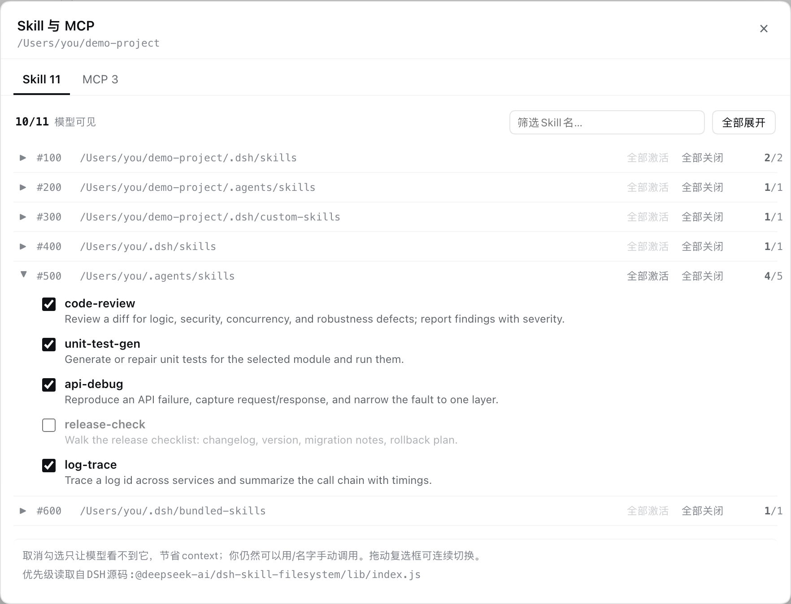
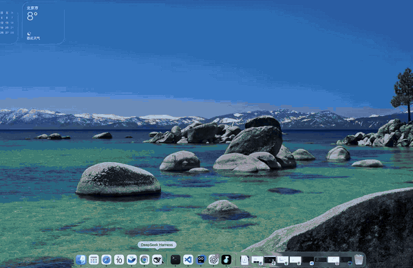

<div align="center">

# Oh My DSH Plugin

**个人开发、开箱即用的 [DeepSeek Harness](https://github.com/deepseek-ai/deepseek-harness)（DSH）插件集合**

[](./LICENSE)

</div>

## 简介

每个插件是一个独立的 npm 包，装上就能在 DSH 的 Web UI 里多一块能力，不用改 DSH 本身，也不用自己编译。

- **开箱即用**：一条安装命令，刷新页面即可使用。
- **独立打包**：一个插件一个包，按需安装、互不依赖。
- **本地优先**：数据默认存在本机，不上传。

## 插件列表

| 插件 | 能做什么 | npm 包名 |
| --- | --- | --- |
| [待办清单](./packages/dsh-todo-list/README.md) | 右上角悬浮待办面板，可按天翻看；重复事项每天一条独立实例，支持优先级、工作日历与到点提醒 | [`@ultraslow/dsh-todo-list`](https://www.npmjs.com/package/@ultraslow/dsh-todo-list) |
| [Skills & MCP](./packages/dsh-skill-mcp-manager/README.md) | <br>按 DSH 真实优先级展示工作区加载的 Skill，取消勾选即对模型隐藏（`/名字` 仍可用）；MCP 分全局与工作区两级 | [`@ultraslow/dsh-skill-mcp-manager`](https://www.npmjs.com/package/@ultraslow/dsh-skill-mcp-manager) |
| [开屏与壁纸](./packages/dsh-boot-skin/README.md) | <br>启动时播放你自己的开屏视频，并把图片/视频铺成界面壁纸，透明度与模糊等实时可调 | [`@ultraslow/dsh-boot-skin`](https://www.npmjs.com/package/@ultraslow/dsh-boot-skin) |
| [机票 / 酒店价格监控](./packages/dsh-price-watch/README.md) | 盯机票与酒店价格：机票不定日期看未来一年每日最低价，定了日期采真实航班与乘客含税实价；酒店按城市+门店+住期采房型与最低整段总价。带走势图与飞书卡片，内容不变不重复推送 | [`@ultraslow/dsh-price-watch`](https://www.npmjs.com/package/@ultraslow/dsh-price-watch) |

## 安装方式

`<profile>` 换成你的 profile 名（如 `desktop`、`web`）。

**从插件市场**：DSH 里打开 **插件 → 实验性插件 → 自定义插件索引**，添加索引源

```text
https://raw.githubusercontent.com/Hankerlove/oh-my-dsh-plugin/main/market/index.json
```

然后在 **插件 → 发现** 里选择安装。

**从 npm**（把包名换成想要的插件）：

```sh
dsh plugin --profile <profile> add @ultraslow/dsh-todo-list
dsh plugin --profile <profile> add @ultraslow/dsh-skill-mcp-manager
dsh plugin --profile <profile> add @ultraslow/dsh-boot-skin
dsh plugin --profile <profile> add @ultraslow/dsh-price-watch
```

**从源码**：

```sh
git clone https://github.com/Hankerlove/oh-my-dsh-plugin.git
cd oh-my-dsh-plugin
dsh plugin --profile <profile> add ./packages/dsh-price-watch
```

装完用该 profile 启动 DSH 并刷新页面即可；卸载把 `add` 换成 `remove`。

## 插件使用

### 待办清单

- **位置**：默认在页面右上角。拖动标题栏移动；收起按钮缩成胶囊（可拖动），点胶囊展开；准星或双击标题栏回到默认位置。
- **按天查看**：默认今天，`‹` `›` 翻日、点日期跳转，「逾期 N」跳到最早逾期日；过去某天可看当天完成情况，未来只读。
- **添加**：标题 + 日期 + 可选时间 + 重复规则 + 优先级，回车即添加；重复事项按天生成独立实例。
- **重复规则**：不重复 / 工作日 / 周末 / 每天 / 每周 / 每月 / 每年，工作日与周末跟随中国法定节假日与调休（内置 2026–2027 年）；完成今天不影响明天，漏做只记「未完成」。
- **优先级**：无 / P0 / P1 / P2，行首色条 + 徽章区分。
- **到点提醒**：带时间的当天实例到点弹提醒卡片（完成 / 稍后 10 分钟 / 知道了），并播放轻提示音；系统支持时还会发系统通知。

更细的说明见[插件说明](./packages/dsh-todo-list/README.md)。

### Skills & MCP

- **入口**：普通会话在头部工具条齿轮；新会话在输入框上方「标准模式」右侧的 `◎ Skill 与 MCP`。
- **Skill**：按真实优先级分组；取消勾选只让模型看不到（`/名字` 仍可用），支持整组开关与拖动连续切换。
- **MCP**：分「全局」与「本工作区」，保存即生效（全局写入 profile 的 `cordis.patch.yml`）。

更细的说明见[插件说明](./packages/dsh-skill-mcp-manager/README.md)。

### 开屏与壁纸

- **入口**：设置 → 插件 → 「开屏与壁纸」。
- **开屏视频**：选本地视频（建议 5–10 秒 H.264 mp4），下次启动全屏播一次；点击画面或 `Esc` 跳过，坏文件自动放行不卡界面。
- **壁纸**：选图片或视频；被界面挡住时把「界面不透明度」调低（建议 75–90）。
- **可调参数**：开屏的不透明度/渐入渐隐/最长时长/静音/是否可跳过，壁纸的不透明度/模糊/暗化/填充方式/界面通透度；滑杆松手即生效，不用重启。
- 媒体与配置存在 `$DSH_HOME/boot-skin/`，不上传网络。
- **素材来源**（使用前请遵守对应仓库许可）：[NativeDog1/dsh-boot-animation · media](https://github.com/NativeDog1/dsh-boot-animation/tree/main/media)、[lxj5820/dsh-boot-animation · assets/videos](https://github.com/lxj5820/dsh-boot-animation/tree/main/assets/videos)。

更细的说明见[插件说明](./packages/dsh-boot-skin/README.md)。

### 机票 / 酒店价格监控

侧栏点价格标签图标打开整页面板，顶部按「机票 / 酒店」切换。**定了日期才算监控，没定日期只看行情**（机票）。

- **机票 · 行情**（不填日期）：一次拿到未来一年每天的最低含税价，画成日历图；点某一天的柱子就能「钉住」这天，变成监控。
- **机票 · 监控**（填了日期）：从登录态的携程页面读真实航班（航班号/航司/时刻/机场）与每位乘客的含税实付价，可选单程或往返（往返还会比较「联程组合」与「两段单买」哪个便宜）。
- **酒店 · 监控**：填城市 + 酒店名称 + 入住/离店日期 + 入住人数。酒店名支持**实时联想**，点选具体门店后创建；提交前会先去携程确认这家酒店存在，查不到或匹配到多家都会直接报错、不建任务。采集结果是该住期的**房型列表**（房型/床型/面积/每晚/整段）与**最低整段总价**。
- **采集频率**：30 分钟到 24 小时自选（默认 6 小时），调度带 ±15% 抖动；被携程风控挡住时该任务跳过一轮，不连续硬撞。
- **飞书通知**：每轮采集尝试推一张卡片，含结论、走势图（纯 JS 渲染，不启动浏览器）、明细表与采集信息；**内容与上次相同就不推**，也不做重试。企业自建应用通道能带图，自定义机器人通道只有文字。
- **需要登录**：机票监控与酒店价格都要先登录携程（设置 → 用户登录）；行情与酒店联想不需要登录。采集用 `playwright-core` 驱动本机已安装的 Chrome，不下载 Chromium。
- **数据**：全部存在 `$DSH_HOME/price-watch/`，登录态在插件自己的浏览器 profile 里，不写进任何 JSON。已过期的机票/酒店监控会自动删除。
- **手机查看**：同一局域网内可直接打开 DSH 的 `/price-watch/` 只读页面。

更细的说明（口径、卡片样式、故障排查）见[插件说明](./packages/dsh-price-watch/README.md)。

## 许可证

[MIT](./LICENSE)
