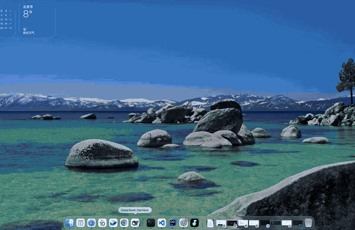

# 开屏与壁纸 · @ultraslow/dsh-boot-skin

给 [DeepSeek Harness](https://github.com/deepseek-ai/deepseek-harness)（DSH）Web UI 加一段自己的开机片头，并把图片或视频铺成整屏壁纸。两者共用同一份媒体库，参数在设置里实时可调。



<sub>动图 17s：等待过程已剪掉，开屏片头与壁纸均为原速完整播放</sub>

| 项 | 值 |
| --- | --- |
| npm 包名 | [`@ultraslow/dsh-boot-skin`](https://www.npmjs.com/package/@ultraslow/dsh-boot-skin) |
| 版本 | `0.1.0` |
| 适用 | DSH Web UI（已在 DSH Desktop 上验证） |
| 协议 | [MIT](../../LICENSE) |

## 能做什么

| 能力 | 说明 |
| --- | --- |
| 开屏视频 | 启动 / 刷新页面时全屏播放一次；可点击或按 `Esc` 跳过；超时强制进入主界面（默认 15s，可调） |
| 首帧不闪 | 宿主在页面 HTML 里内联首帧盖板，不会先看到「Loading plugins…」或主界面再被盖住 |
| 视频参数 | 不透明度、渐入时长、渐隐时长、最长时长、静音、允许跳过、每次启动只播一次 |
| 壁纸 | 图片（PNG / JPEG / WebP / AVIF / GIF）或视频，铺在整个界面下方 |
| 壁纸参数 | 不透明度、模糊、暗化、填充方式（cover / contain / fill）、界面通透度 |
| 视频壁纸播放方式 | 循环播放一直播；播放一次会在片头结束后播一遍并停住，切换会话时重播 |
| 片头与壁纸的交接 | 壁纸视频等片头谢幕后才开始播，不会在遮挡期间偷偷播完 |
| 媒体上传 | 设置页直接选本地文件，上传即生效，不需要重启、不需要改任何宿主文件 |

## 安装方式

`<profile>` 换成你的 profile 名（例如 `desktop`、`web`）。

### 从 npm 安装

```sh
dsh plugin --profile <profile> add @ultraslow/dsh-boot-skin
```

### 从源码安装

```sh
git clone https://github.com/Hankerlove/oh-my-dsh-plugin.git
cd oh-my-dsh-plugin
dsh plugin --profile <profile> add ./packages/dsh-boot-skin
```

安装后重启 DSH，刷新 Web UI 页面，进入**设置 → 插件 → 「开屏与壁纸」**上传素材。

卸载：

```sh
dsh plugin --profile <profile> remove @ultraslow/dsh-boot-skin
```

卸载会同时移除两个视觉层与界面 token 覆盖，界面立即回到原样；已上传的媒体留在 `$DSH_HOME/boot-skin/media/`，可手动删除。

## 使用

### 开屏视频

选一段本地视频（推荐 5–10 秒、H.264 的 mp4），打开「启用开屏视频」。想立刻看效果就点「预览开屏」；真正的开机播放会在下次启动 DSH 时发生。

### 壁纸

选一张图片或一段视频，打开「启用壁纸」。若壁纸被界面挡住，把「界面不透明度」往低调（建议 75–90）。

壁纸的内容区不覆盖窗口最上方约 48px 的标题条——那是系统的窗口拖动区，用一个覆盖层盖住它会让整个窗口无法拖动（Chromium 重算窗口拖动矩形时不认 `pointer-events: none`，实测症状是「第一次能拖、之后拖不动」）。

为了让画面仍然铺满，同一份素材会**同时**画到 `body` 背景上：背景不是元素，不参与命中测试，因此标题条显示的是同一张画面（视频取一帧静态图），而内容区仍然是会动的视频。

### 视频壁纸的播放方式

- `循环播放` —— 一直播。
- `播放一次` —— 片头结束后从头播一遍，播完停在最后一帧；之后**切换到别的会话**会从头重播。

### 参数一览

| 分组 | 参数 | 范围 / 取值 |
| --- | --- | --- |
| 开屏视频 | 启用、静音、允许跳过、每次启动只播一次 | 开关 |
| 开屏视频 | 不透明度 | 0–100% |
| 开屏视频 | 渐入 / 渐隐时长 | 0–3000ms |
| 开屏视频 | 最长时长 | 1–60s（兜底，防止卡在开屏） |
| 壁纸 | 启用 | 开关 |
| 壁纸 | 壁纸不透明度 | 0–100% |
| 壁纸 | 模糊 | 0–40px |
| 壁纸 | 暗化 | 0–100% |
| 壁纸 | 填充方式 | `cover` 铺满裁切 / `contain` 完整显示 / `fill` 拉伸 |
| 壁纸 | 界面不透明度 | 40–100%（越低壁纸越明显，但文字越难读） |
| 壁纸（视频） | 播放方式 | 循环播放 / 播放一次 |

所有滑杆都是**松手后约 150ms 提交一次**：拖动过程中界面即时跟手，且不会让壁纸视频重播。

「界面不透明度」表示的是「壁纸还剩多少可见度」，而不是「每一层界面多不透明」：DSH 的界面表层由多层嵌套容器绘制，插件通过官方 `ctx.theme.overrideTokens` 把这些 token 改成带 alpha 的颜色，并按嵌套层数做了补偿。

### 素材建议

| 用途 | 格式 | 体积上限 | 建议 |
| --- | --- | --- | --- |
| 开屏视频 | mp4(H.264) / webm | 80MB | 5–10 秒、无音轨或静音；带声音的自动播放在浏览器侧通常会被拦，插件会自动降级为静音重试 |
| 壁纸图片 | png / jpeg / webp / avif / gif | 40MB | 亮度适中，配合「暗化」保证文字可读 |
| 壁纸视频 | mp4 / webm | 40MB | 静音、循环友好；竖屏或超宽屏也能正确铺满（`object-fit: cover`） |

## 数据与隐私

- 全部保存在本机 `$DSH_HOME/boot-skin/`：

  ```text
  boot-skin/
  ├── config.json      # 参数与媒体索引
  └── media/           # 上传的文件（按内容哈希命名）
  ```

- 不走网络、不上传云端。宿主只在 `127.0.0.1` 上提供读取路由，写操作带来源校验（优先使用 DSH 的连接信任围栏 `connection.requestRejection`）。

## 许可证

[MIT](../../LICENSE)
