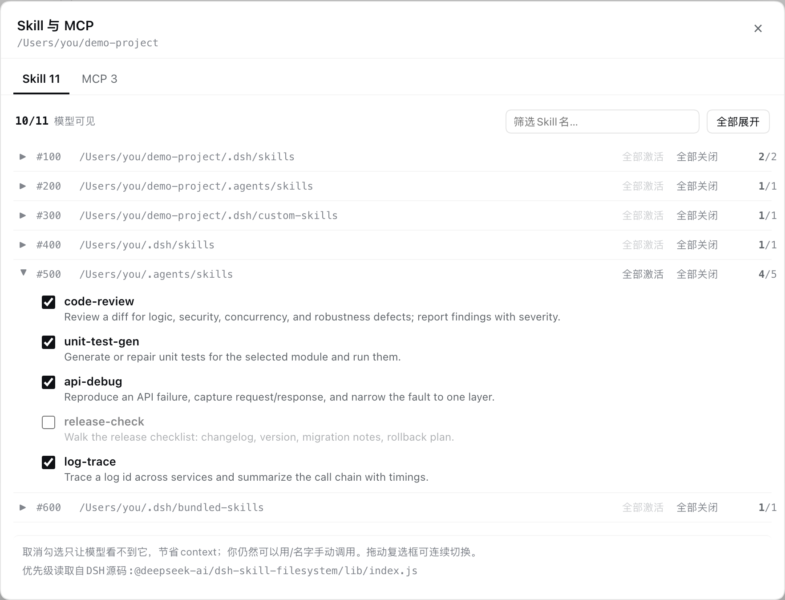
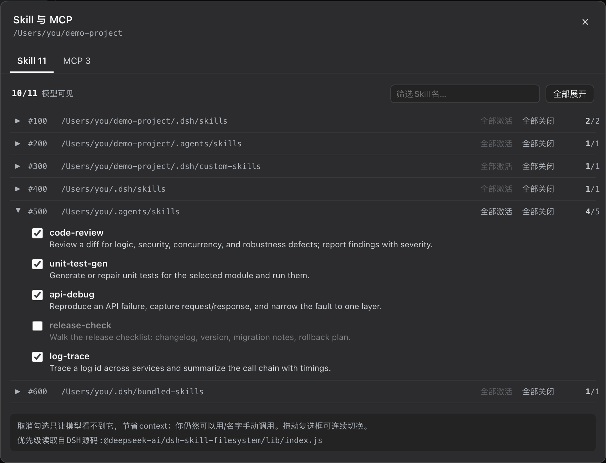
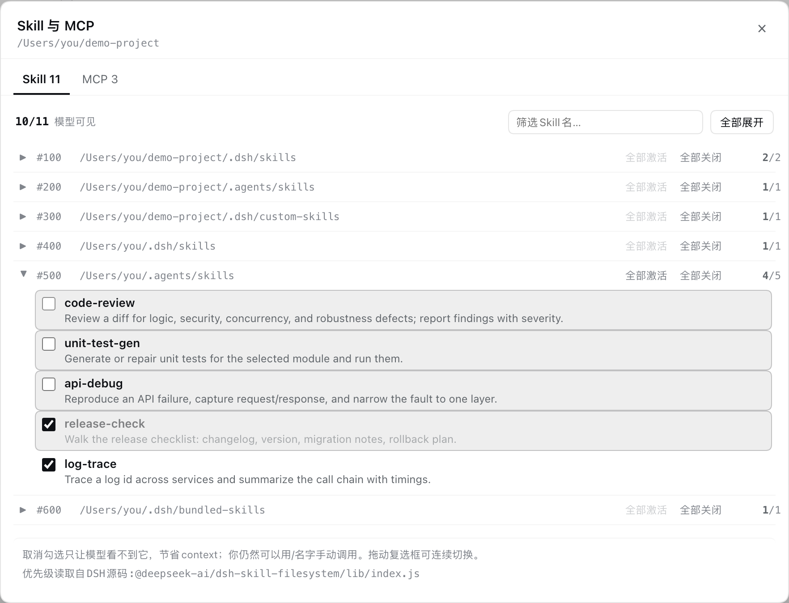
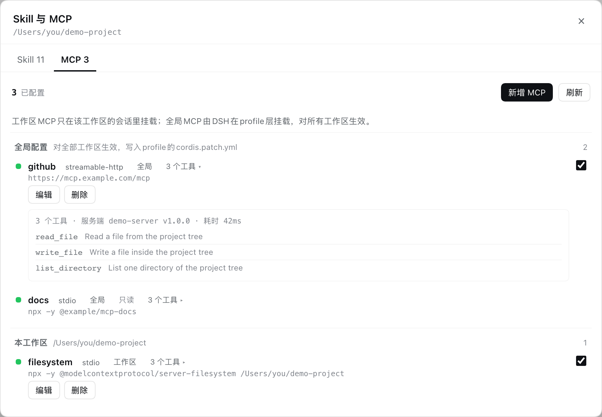

# Skill 与 MCP · @ultraslow/dsh-skill-mcp-manager

给 [DeepSeek Harness](https://github.com/deepseek-ai/deepseek-harness)（DSH）Web UI 加一个**按工作区**管理 Skill 与 MCP 的面板：Skill 按 DSH 真实优先级展示、可整组开关；MCP 分「本工作区」与「全局」两级，全局配置写入 profile 的 `cordis.patch.yml`，对所有工作区生效。

| 项 | 值 |
| --- | --- |
| npm 包名 | [`@ultraslow/dsh-skill-mcp-manager`](https://www.npmjs.com/package/@ultraslow/dsh-skill-mcp-manager) |
| 版本 | `0.1.0` |
| 适用 | DSH `>=0.2.2-rc.1 <0.3.0`（Web UI；已在 DSH Desktop 验证） |
| 协议 | [MIT](../../LICENSE) |









> 截图使用示例数据（虚拟工作区与服务器），不含任何真实 Skill / MCP 配置。

## 能做什么

| 能力 | 说明 |
| --- | --- |
| 入口 | 普通会话在头部工具条齿轮；新建会话（blank/hero）在输入框上方、「标准模式」右侧的 `◎ Skill 与 MCP`。`Esc` 或点遮罩关闭 |
| Skill 台账 | 按 DSH 运行时解析出的 rank（100 → 600）分组，标出每个 rank 实际扫描的目录与 `已激活/全部`，可按名字筛选 |
| Skill 开关 | 勾选控制「模型是否可见」；取消勾选只隐藏目录条目并拒绝 `skill` 工具调用，`/名字` 手动调用仍可用 |
| 批量与拖动 | 每个分组可「全部激活 / 全部关闭」；按住任意勾选框上下拖动，拖过几行就切换几行（每行按当前状态取反），一次请求提交 |
| 工作区 MCP | 新增/编辑/删除/启停，支持「测试连接」；按会话挂载，只影响当前工作区 |
| 全局 MCP | 新增/编辑/删除/启停，写入 profile 的 `cordis.patch.yml`，对所有工作区生效；bundle/home 层提供的行只读展示 |
| 工具探测 | 打开 MCP 页自动逐台试连，显示真实工具数；点开可看工具清单（名称 + 描述） |
| 数据本地 | 工作区配置存 `$DSH_HOME/skill-mcp-manager/config.json`；全局 MCP 存 profile 的 `cordis.patch.yml`；不上传 |

## 安装方式

`<profile>` 换成你的 profile 名（例如 `desktop`、`web`）。

### 从 npm 安装

```sh
dsh plugin --profile <profile> add @ultraslow/dsh-skill-mcp-manager
```

### 从源码安装

```sh
git clone https://github.com/Hankerlove/oh-my-dsh-plugin.git
cd oh-my-dsh-plugin
dsh plugin --profile <profile> add ./packages/dsh-skill-mcp-manager
```

安装后用该 profile 启动 DSH，并**刷新 Web UI 页面**：普通会话会在头部工具条出现齿轮；新建会话时入口位于输入框上方「标准模式」右侧。

卸载：

```sh
dsh plugin --profile <profile> remove @ultraslow/dsh-skill-mcp-manager
```

卸载不会删除已写入的 `$DSH_HOME/skill-mcp-manager/config.json`，也不会回收全局 MCP 在 profile 的 `cordis.patch.yml` 中插入的行（需要时手动删除这些行）。

## 使用

### 入口

| 场景 | 入口 |
| --- | --- |
| 普通会话 | 会话头部工具条（`conversation.session.header.actions`）上的齿轮图标 |
| 新建会话（blank/hero，头部 chrome 被宿主隐藏） | 输入框上方选项行、紧跟「标准模式」右侧的 `◎ Skill 与 MCP` 文字入口（`conversation.hero.options`） |

两个入口同一时间只显示一个；面板绑定**当前会话所属工作区**（面板顶部显示其绝对路径）。`Esc` 或点击遮罩关闭。

### Skill 页

- 按 rank 升序分组（100 → 600），组标题为 `#rank · 该 rank 的真实目录 · 已激活/全部`，默认收起；「全部展开 / 全部收起」一键切换。
- 每行只显示 `名字 + 描述`；顶部显示 `已激活/总数` 与「模型可见」；右上角为名称筛选。
- 勾选 = 对模型可见；取消 = 从后续目录中过滤，且 `skill` 工具调用被拒绝（`/名字` 不受影响）。
- **整组批量**：组标题右侧 `全部激活 / 全部关闭`，只提交需要变化的那部分行，一次请求写入。
- **拖动连续切换**：按住任意行的勾选框上下拖动，拖过的行整段高亮并预览结果，松手后每行按当前状态取反（已激活→关闭，未激活→激活），一次请求提交。单击行正文不会误触，只有勾选框与拖动会切换。
- 面板底部把「勾选说明 + rank 表来源 + 回退提示」合并为一个信息块；来源只显示 `优先级读取自DSH源码:@deepseek-ai/dsh-skill-filesystem/lib/index.js` 这类短行。

### MCP 页

列表按作用域分为两段（无内容时不显示段标题，也不显示空态文案）：

| 段 | 行标签 | 可编辑 | 说明 |
| --- | --- | --- | --- |
| 全局配置 | `全局` | 是 | 来自 profile 的 `cordis.patch.yml`，对全部工作区生效 |
| 全局配置 | `全局` `只读` | 否 | 来自 bundle / home patch 层，本插件不改动 |
| 本工作区 | `工作区` | 是 | 来自 `$DSH_HOME/skill-mcp-manager/config.json` |

行内信息：连接状态点、`serverName`、传输类型、作用域、真实工具数徽标（点击展开/收起工具清单）、启动命令或 URL；工具清单一行一个工具（等宽名称 + 单行描述，最高 200px 滚动），失败行显示错误原因。

工具栏只有一个 `新增 MCP`；**作用域在表单里点选**——两个并排的可点击选项 `工作区 / 全局`（不是下拉框），点选即切换并实时更新下方说明；编辑既有行时作用域固定为只读文本。表单字段：

| 字段 | stdio | streamable-http |
| --- | --- | --- |
| 作用域 | 两个可点选项 `工作区` / `全局`（新增可切换，编辑固定；下方提示写入位置与生效范围） | 同左 |
| `serverName` | 顶部单行（校验 `[A-Za-z0-9_-]{1,32}`） | 同左 |
| 类型 / 命令或 URL | 同一行：`类型 [stdio ▾] 命令 [npx]` | 同一行：`类型 [streamable-http ▾] URL [https://…]` |
| 参数（args） | 逐行增删，`+ 添加` 在下方、`×` 在最右 | — |
| 环境变量（env） | KEY/value 同一行增删 | — |
| Headers | — | KEY/value 同一行增删 |
| 启用 | 开关 | 开关 |

- 表单为两列对齐布局（左侧标签列、右侧控件列）；列表为空时 `+ 添加` 与字段标签底部对齐，已有行时紧跟在最后一行下方。
- **测试连接**：使用与挂载相同的 MCP SDK 与同等环境变量做一次性握手（stdio 起临时子进程 / HTTP 建临时连接），显示服务端名称、工具数与工具名；只试连，不写配置、不注册工具。
- 打开 MCP 页时会**自动逐台探测**（每次打开 / 刷新都会重新探测），因此列表展示的是真实工具数而不是自维护的挂载计数。

## 作用域与生效时机

| 操作 | 影响范围 | 何时生效 |
| --- | --- | --- |
| Skill 开关 | 该工作区（含其子代理） | 目录文本：下一次目录重发（新会话，或目录本身发生变化）；`skill` 工具调用：**立即**被拒；`/名字`：始终可用 |
| 工作区 MCP 新增/编辑/启停/删除 | **该工作区**所有已开会话 + 该工作区新会话 | **立即**：保存后对活跃会话做挂载 diff，下一步工具可用 |
| 全局 MCP 新增/编辑/启停/删除 | **所有工作区** | **立即**：写入 `cordis.patch.yml` 并触发 profile 重算；无 HMR 的环境需重启（面板会提示） |

说明：

- 「立即」指的是模型下一次请求的工具清单与系统提示已反映变化；已经写进历史对话的内容不会被撤回。
- Skill 开关之所以不立即反映到目录文本，是因为 DSH 只在 digest 变化时重发目录（见「背景知识」）。**推荐做法：开新会话前把该工作区的 Skill 配置调好。**
- 全局 MCP 行由 DSH 在 profile 层挂载，与具体会话无关；工作区 MCP 行挂在会话自己的 agent ctx 上，会话结束即回收。

## 边界（不做什么）

- **不安装、不卸载、不修改任何 Skill 文件**。关闭只影响「模型可见/可调用」，`SKILL.md` 原样保留，用户 `/名字` 仍可手动触发。
- **不接管 Skill 发现**。发现、rank、同名冲突、`customSkillDirs` 等仍由 DSH 的 `@deepseek-ai/dsh-skill` / `dsh-skill-filesystem` 决定；本插件只在目录文本产出后做过滤。
- **不修改 DSH 源码，不 fork 宿主**；不改项目目录（不写 `.dsh/`、不写 `.agents/`）。
- **不管理 profile 的 bundle 列表**（安装/升级/删除 bundle 请用 `dsh plugin` 或插件管理器）；本插件只写 profile patch 里**自己插入的 MCP 行**。
- **不改全局配置的其它内容**：`cordis.patch.yml` 中与本插件无关的 patch 项与注释保持原样。
- **不代理 MCP 协议**。MCP 客户端、工具注册、重连全部由 `@deepseek-ai/dsh-mcp-client` 负责；本插件只负责配置与一次性试连。
- **不管理模型、API Key、主题等**其它设置。

## 背景知识：DSH 如何加载 Skill 与 MCP

理解作用域与生效时机，需要先了解 DSH 的这几条机制。

### Skill 的发现来源与优先级（rank）

DSH 从多个目录发现 Skill，数字越小优先级越高，同名 Skill 由小数字胜出。这张表**在运行时从本机 DSH 安装的 `@deepseek-ai/dsh-skill-filesystem/lib/index.js` 解析**（`roots()` 与 `*_RANK` 常量），不是本插件写死的：

| rank | 来源 | 目录 | 说明 |
| --- | --- | --- | --- |
| 100 | `project-dsh` | `<项目根>/.dsh/skills` | 项目私有，优先级最高 |
| 200 | `project-agents` | `<项目根>/.agents/skills` | 项目内的 agents 通用目录 |
| 300 | `custom` | 由 agent preset 的 `customSkillDirs` 指定 | 组合层自定义目录 |
| 400 | `user-dsh` | `$DSH_HOME/skills` | 用户级、DSH 自己的目录 |
| 500 | `user-agents` | `~/.agents/skills`（或 `$DSH_AGENTS_HOME/skills`） | 用户级 agents 通用目录 |
| 600 | `bundled` | `$DSH_BUNDLED_SKILL_DIR` / 桌面 runtime 的 office skills | 随 DSH 发行 |

「项目根」= 最近含 `.git` 的祖先目录，否则为会话 cwd。解析失败时面板会明确显示「无法读取 DSH 源码，已改用内置 rank 表」，功能不受影响。

### 模型看到的 Skill 目录（`<available_skills>`）与重发条件

`@deepseek-ai/dsh-tool-skill` 在每一步的 `agent/pre-step` 中算出当前可被模型调用的 Skill 集合，并把它写成一条 `skill-catalog` 用户消息（内容为 `<available_skills>` 列表）。是否重发由 **digest** 决定：

```
digest = sha256( 每个 Skill 的 [name, description(截断 500 字符)] + 是否发现不完整 )
```

- 与上下文中最后一条**可见**目录消息的 digest **相同**：不重发，并把本步消息里那条旧目录消息剔除；
- **不同**：发一条「The available skill catalog changed…」的替换版（会话首次则为初始版）。

会改变 digest 的情况包括：新增/删除/重命名 `SKILL.md`、`description` 变化、`invocation` 标记变化导致 Skill 进出「模型可调用」、工作区/项目根变化、preset 切换、`$DSH_HOME/skills` 或 `~/.agents/skills` 内容变化、发现完整性变化、同名冲突出现或消失。

**本插件的 Skill 开关不改变 digest**：它保留消息里的 `source.entries`（完整列表）只改写文本，因此不会引起每一步重发。代价与后果见「已知限制」。

### 用户 `/名字` 的调用路径

用户在输入里写 `/名字` 时，`dsh-tool-skill` 的另一个 pre-step 监听器会把该 Skill 的 `<skill_content>` 作为用户消息注入会话——这条路径**不经过 `skill` 工具**，因此本插件的工具守卫对它无效，`/名字` 始终可用。

### MCP 的挂载模型

- 一个 MCP 服务器 = 一个 `@deepseek-ai/dsh-mcp-client` 插件实例；
- 实例把自己的工具注册为 `mcp__<serverName>__<tool>`，并把服务端返回的 instructions 注册为 systemPrompt 的 `mcp:<serverName>` 段（内容随连接存活）；
- 实例 dispose 时：工具注销、systemPrompt 段移除、stdio 子进程结束 / HTTP 连接关闭；
- 同一组合内 `serverName` 必须唯一，否则工具名冲突，因此本插件在保存时**跨作用域校验** serverName。

### 配置层叠与热重载

profile 的插件树由 patch 层组合而成，顺序为：各 bundle 的 patch → profile 的 `cordis.patch.yml` → `$DSH_HOME/cordis.patch.yml` → `--patch` 覆盖层。同一 id 的最后一次写入生效；patch 会**整体替换**目标行的 `config`。

长驻进程（Web/桌面）启用了 `dsh-hmr`，它会监视 profile 的 `cordis.patch.yml` 与 home patch，文件变化后按最新 patch 重算目录树：新行被创建、标了 `disabled: true` 的行被 dispose、从 patch 中移除的行被卸载。**全局 MCP 行就是利用这一点实现「保存即生效」**。

## 数据与文件

### 工作区配置

```text
$DSH_HOME/skill-mcp-manager/config.json
```

```json
{
  "version": 1,
  "workspaces": {
    "/abs/path/to/project": {
      "disabledSkills": ["release-check"],
      "servers": [
        {
          "id": "stdio-fs",
          "serverName": "fs",
          "transport": "stdio",
          "enabled": true,
          "command": "npx",
          "args": ["-y", "@modelcontextprotocol/server-filesystem", "/tmp"]
        }
      ]
    }
  }
}
```

- 以工作区绝对路径为键；不写入项目目录；卸载插件不会删除该文件。
- 写入使用「临时文件 + rename」原子替换；文件损坏时保留上一份可用快照（fail-open，不影响会话）。

### 全局 MCP：profile 的 `cordis.patch.yml`

全局行由本插件以 **insert patch** 的形式写入 profile 的用户 patch 层：

```yaml
- insert:
    - id: mcp-fs
      name: '@deepseek-ai/dsh-mcp-client'
      config:
        serverName: fs
        transport: stdio
        command: npx
        args:
          - -y
          - '@modelcontextprotocol/server-filesystem'
          - /tmp
```

写入规则：

- 新增：追加一个 `insert` patch 项，`id` 由 serverName 派生并做组合内唯一化（`mcp-<slug>`）；
- 编辑：整体替换该行的 `config`（patch 语义即为整体替换）；
- 停用：在该行写入 `disabled: true`；启用：移除该键。停用**保留行与配置**，与「删除」不同；
- 删除：把该行从 `insert` 列表移除（列表为空时连同空 patch 项一起移除），并清理同 id 的 `{ id, disabled }` 覆盖项；
- 文件中的其它 patch 项、注释、`!!js` 表达式保持原样；写入前重新解析校验，非法 YAML 拒绝写入；
- 写入顺序：落到磁盘 → 通过 HMR 事务队列立即重算 → 轮询确认运行态（最多 3 秒）；无 HMR 时返回 `restartRequired: true`，面板提示重启。

**只读行**：来自 bundle 或 home patch 的 MCP 行也会显示在「全局配置」段（它们同样对所有工作区生效），但本插件不修改它们。profile patch 没有「remove」语义，因此这类行只能由提供它的层移除。

### 并发

插件对 `cordis.patch.yml` 与 `config.json` 都是「读最新内容 → 修改 → 原子写」。若同时有其它进程（插件管理器、手工编辑）修改同一 patch 文件，最后写入者生效；插件在每次写入前重新读取文件，不会覆盖自己未读到的内容之外的改动。

## HTTP 接口（宿主内部）

浏览器半边通过 `/skill-mcp` 前缀访问宿主，均为同源请求，失败也返回 HTTP 200 + `{ ok: false, error }`：

| 方法 | 路径 | 说明 |
| --- | --- | --- |
| GET | `/skill-mcp/view?session=<id>` | 返回工作区信息、Skill 列表与 rank 分组、禁用集合、MCP 工作区/全局行、运行态、patch 路径 |
| POST | `/skill-mcp/skills` | `{ session, changes: [{ name, enabled }] }`；单条、整组与拖动共用，一次原子写入 |
| POST | `/skill-mcp/mcp` | `action: test \| save \| toggle \| delete`；`save/toggle/delete` 需要 `scope: 'workspace' \| 'global'`，全局行用 `id` / `serverName` 定位，编辑时可带 `previous` |

`test` 与作用域无关：传入一个完整的 server 描述即可试连。

## 兼容性、依赖与回退

| 依赖 | 获取方式 | 缺失时的行为 |
| --- | --- | --- |
| `@deepseek-ai/dsh-mcp-client` | 从当前安装解析（含 `profileContext.installAnchor` 回退） | MCP 页提示「当前 DSH 运行时无法解析…」，Skill 功能不受影响 |
| `yaml`（YAML 解析器） | `import('yaml')`，失败时从安装 anchor 解析 | 全局 MCP 编辑不可用并给出明确错误；工作区 MCP 不受影响 |
| `dsh-hmr` | 宿主服务 `hmr` | 全局改动写入磁盘但不热生效，返回「需要重启」提示 |
| DSH 源码（rank 表） | 解析 `dsh-skill-filesystem/lib/index.js` | 使用内置 rank 表并在面板提示 |

`@modelcontextprotocol/client` 的 `Client` / `StreamableHTTPClientTransport` / `StdioClientTransport` 用于一次性试连，版本跟随运行时自带（当前 2.2.x）。

## 已知限制

1. **Skill 目录文本不在会话中途重发**：开关只即时作用于工具守卫；已发出的 `<available_skills>` 文本保持到下一次目录重发（通常是新会话）。反向亦然：会话中途启用的 Skill 不会立刻出现在旧会话目录里，但 `/名字` 可用。
2. **已加载的 Skill 内容不会撤回**：关掉之前已经加载进上下文的指令仍在历史中。
3. **`/` 菜单仍会列出被隐藏的 Skill**：那是宿主的用户侧菜单，不在过滤范围内。
4. **全局 MCP 只能管理 patch 中 insert 的行**；bundle/home 层提供的行只读（见「数据与文件」）。
5. **停用 ≠ 删除**：停用写 `disabled: true`，配置仍在；删除才移除整行。
6. **serverName 跨作用域唯一**：全局与任一工作区不能使用同一个 serverName（否则工具名冲突），保存时直接拒绝并给出冲突位置。
7. **工作区 MCP 按会话挂载**：同一工作区开 N 个会话即 N 份连接 / N 个 stdio 子进程（与 DSH 原生 MCP 的会话语义一致）。
8. **工具数来自一次性探测**，不是常驻连接状态；若出现「已连接但工具 0」，通常是重连耗尽后 fiber 仍存活。
9. **rank 表依赖 DSH 源码结构**；未来版本改变 `roots()` 写法时回退内置表（开关与 MCP 功能不受影响）。
10. **子代理共享工作区判定**，因此同一工作区的子代理与主会话看到相同的 Skill 过滤结果。
11. **无 HMR 的环境**（部分 headless 组合）修改全局 MCP 需要重启 DSH。
12. **并发写同一 patch 文件**时最后写入者生效（见「数据与文件 · 并发」）。
13. **极端情况下运行态可能滞后**：若 HMR 重算失败（例如同时安装了新依赖），已删除的全局行可能仍以「只读」形式出现在列表里直到重启；重启 DSH 即可恢复一致。

## 故障排查

| 现象 | 原因 | 处理 |
| --- | --- | --- |
| 面板底部显示「无法读取 DSH 源码，已改用内置 rank 表」 | rank 源解析失败 | 功能可用；升级 DSH 后会自动重试 |
| 「全局配置」段提示「无法读取 profile 的 cordis.patch.yml」 | 手写 YAML 非法，或该文件不是序列 | 修正 YAML（必须是 patch 列表）后刷新 |
| 「this DSH runtime cannot resolve a YAML parser / did not expose the profile patch path」 | 运行时没有 `yaml` 或没有 `profileContext` | 全局编辑不可用；工作区 MCP 与 Skill 不受影响 |
| MCP 页提示「无法解析 @deepseek-ai/dsh-mcp-client」 | 运行时缺少该包 | 检查 DSH 安装/版本 |
| 测试连接报 `ENOENT` / `not found` | 宿主 PATH 中找不到命令 | 用绝对路径，或在 `env` 中补齐所需变量；试连与挂载使用同一套环境变量 |
| 保存全局 MCP 后列表未变化 | 该环境没有热重载，或 HMR 重算失败 | 按面板提示重启 DSH；或等待 1–2 秒后刷新 |
| 删除的全局行仍出现在「全局配置」且带「只读」 | 运行态未卸载（HMR 失败），patch 已删除 | 重启 DSH；文件本身已正确 |
| 保存时报 serverName 冲突 | 同一名字已存在于工作区或全局 | 改名，或先删除冲突项 |
| 打开 MCP 页较慢 | 每台服务器都会做一次探测（20 秒超时） | 停用不需要的服务器可跳过探测 |

## 开发与验证

纯 ESM，无构建步骤：宿主 `index.js`，浏览器 `client.js`（由 `package.json` 的 `dsh.client` 声明、`exports["./client"]` 暴露，`window.__ModuleLoader__.load({ id, factory })` 格式），文案在 `locale/*.json`。

```sh
# 语法检查
node --check index.js && node --check client.js

# 只组合配置、不启动服务
DSH_HOME=/tmp/dsh-test node "<DSH 安装>/node_modules/@deepseek-ai/dsh/lib/bin.js" \
  --profile test --dump-config | grep -A2 skill-mcp-manager
```

用临时 profile 做端到端验证（推荐，不污染真实 profile）：

```sh
export DSH_HOME=/tmp/smm-home
mkdir -p "$DSH_HOME/profiles/test/node_modules/@ultraslow"
ln -sfn "$PWD" "$DSH_HOME/profiles/test/node_modules/@ultraslow/dsh-skill-mcp-manager"
cat > "$DSH_HOME/profiles/test/package.json" <<'JSON'
{ "name": "dsh-profile-test", "private": true,
  "dsh": { "profile": { "bundles": ["@deepseek-ai/dsh-base", "@deepseek-ai/dsh-web-app", "@ultraslow/dsh-skill-mcp-manager"] } } }
JSON
printf '[]\n' > "$DSH_HOME/profiles/test/cordis.patch.yml"
printf '[]\n' > "$DSH_HOME/profiles/test/cordis.yml"
node "<DSH 安装>/node_modules/@deepseek-ai/dsh/lib/bin.js" --profile test --no-open --port 51700
```

修改后在真实 profile 中生效：`plugin_manager` 对 `include:skill-mcp-manager` 执行 disable → enable，然后**刷新页面**（宿主会热换行，浏览器需重新拉取 client bundle）。

## 文件结构

```text
packages/dsh-skill-mcp-manager/
├── index.js              # 宿主：/skill-mcp 路由、Skill 目录过滤与工具守卫、MCP 挂载与 profile patch 读写
├── client.js             # 浏览器：入口、面板、Skill 页、MCP 页、样式
├── cordis.patch.yml      # bundle patch：插入本插件宿主行
├── locale/{zh,en}.json   # 插件元信息文案
├── docs/                 # 截图
└── README.md
```
